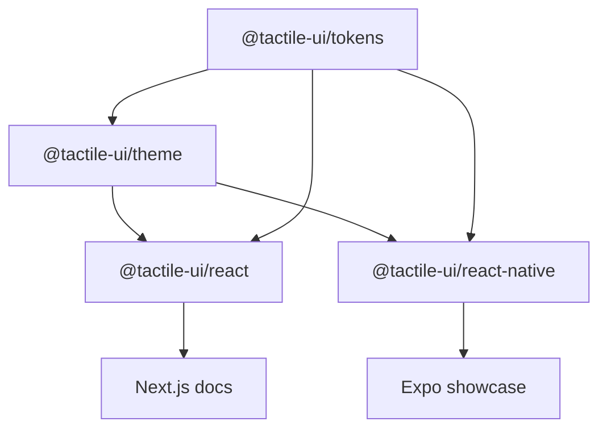

# Architecture

## Contract

Expo-first with bare React Native compatibility as a goal. Native views are the baseline; advanced rendering is optional and isolated. npm packages are the first distribution format. Phase 1 contains infrastructure, tokens, themes, adapters, and app shells, without a component catalog.

## Dependency direction

Arrows show the flow of shared design decisions. Runtime imports flow in the reverse direction. Apps never supply library code. The web adapter never imports React Native; the native adapter never imports React DOM, browser globals, Expo, or advanced engines. Tokens and themes do not depend on React.

## Tokens and themes

`tokens` holds numeric, platform-neutral dimensions; typography, radius, depth, motion, and accessibility values; and a primitive palette. Numeric dimensions map to CSS px or native dp. Typography maps to rem on web and scalable native font sizes. The depth model deliberately avoids CSS box-shadow strings and platform APIs.

`theme` resolves primitives to semantic colors. `createTheme({ mode, colors, radius })` performs typed partial overrides with fresh color/radius records; it never mutates a preset. The public types are readonly. Shared primitive objects are immutable by contract; do not cast away readonly and mutate them. Light and dark presets include paired foregrounds. Custom colors are not automatically contrast-corrected and must work on both platforms.

The web provider owns a scoped div with CSS variables and `color-scheme`. The native provider owns context only, preserving layout and accessibility trees. Consumers can nest providers to create local themes. Explicit `theme` overrides preference on both platforms.

Web system appearance is subscribed to after mount; `initialMode` produces deterministic SSR and hydration, defaulting to light. A system-dark user can see a brief light frame on first load unless an app supplies an appropriate server-known initial mode. We avoid an undocumented blocking script or hydration suppression. Theme persistence is app policy, not a base-package side effect. Native follows `useColorScheme`, with light fallback when unavailable.

Motion tokens include an instant duration. Future animated components must respect reduced motion; no animation runtime or animated controls ship in Phase 1.

## Platform rendering

Web will use semantic HTML and CSS. Native will use React Native View, Text, Pressable, accessibility properties, native shadow/elevation, and platform conventions. No native component module, config plugin, linking step, or Expo runtime is required by the native library itself.

The style adapter maps shared blur to `shadowRadius = blur / 2`, with independent Android elevation. This is an approximation, not pixel-identical rendering. Native inset shadows and custom materials are explicitly unsupported by the baseline capability contract.

### Optional advanced rendering boundary

`RenderingCapabilities` and `nativeRendering` describe the baseline without loading an engine. A future `@tactile-ui/renderer-skia` (or similar) must be a separate package. It may depend on shared tokens/themes and declare its own engine peers. Neither base adapter may import or re-export that package. Consumers must opt in explicitly; semantic controls and interaction stay owned by platform views. Unsupported effects must fall back to native views rather than require a rendering engine. No speculative renderer implementation or dependency is included now.

Haptics and gesture/animation adapters will follow the same explicit opt-in model; Expo-specific code belongs in an Expo adapter, not in the native base.

## Package and build strategy

Four publishable packages use tsup to emit ESM (`.js`), CommonJS (`.cjs`), declarations (`.d.ts`/`.d.cts`), and source maps. Dependencies and platform peers remain external. Export maps and the native condition resolve to built files, not workspace-only source paths. React adapters preserve a client boundary for Next.js. The pure theme/token packages remain usable by server code.

`workspace:^` links packages locally and becomes a semver dependency in packed archives. Publishable file lists include only dist and README. The package check actually packs and unpacks archives, inspects entrypoints and dependency boundaries, and imports the packed token module in both ESM and CommonJS.

Turborepo schedules dependencies before consumers; builds cache `dist` and `.next` excluding the Next cache. Long-running development tasks are uncached. Type checks and tests depend on dependency builds so clean-checkout commands resolve package declarations. pnpm's lockfile fixes the installed dependency graph.

## Compatibility baseline

The initial app baseline is Expo SDK 58, React Native 0.88, React 19.3, Next.js 16.4, and Node 24. Native package peers intentionally describe the tested baseline rather than promise unverified older versions. Apps use a single React version. Bare React Native support is a structural goal, not yet a verified host-app integration: the base package has no Expo imports, but an external bare-host device test remains required before making a compatibility claim.

The showcase includes Expo's system UI module so automatic Android appearance is honored in development builds; this dependency is confined to the app. Expo uses default Metro monorepo support and isolated pnpm installs. No custom watch folders, resolver aliases, React Native Web dependency, or Next.js native alias is needed. Web and native use separate apps.

Sources consulted: [Expo monorepos](https://docs.expo.dev/guides/monorepos/), [Expo SDK compatibility](https://docs.expo.dev/versions/latest/), [Next.js installation](https://nextjs.org/docs/app/getting-started/installation), and [Turborepo internal packages](https://turborepo.dev/docs/core-concepts/internal-packages). Exact selected versions are pinned by the lockfile; documentation's latest versions can change.

## Tests and releases

Vitest covers contract behavior, built-in contrast, custom theme isolation, scoped/nested web providers, SSR, preference subscriptions, and native adapter mappings. Native adapter tests mock the minimal React Native surface; they do not claim native view rendering. Next and Metro production builds verify actual app bundling. Playwright covers browser theme controls, keyboard skip navigation, runtime errors, and mobile overflow.

CI installs from a frozen lockfile, checks formatting, runs `pnpm check`, validates Expo's dependency matrix, and runs browser checks. Xcode/Gradle binary builds, native accessibility checks, Dynamic Type, device gestures, and a bare-host smoke test remain distinct checks.

Changesets uses independent versions with dependency patch updates. A changeset records the initial foundation. Versioning and publishing are explicit maintainer actions; CI never publishes. Scope ownership, license, package metadata, and registry access must be settled before release.

## Phase 2: surface engine

`@tactile-ui/theme` now owns the framework-free `resolveSurfaceRecipe`, `SurfaceOptions`, `SurfaceRecipe`, `surfacePresets` and deterministic native fill-band helper. This extends the existing dependency graph without introducing a new package or dependency. Rendering decisions remain separate: DOM `Surface`/`surfaceToCSS` use CSS, and native `Surface`/`surfaceToNativeStyles` use View layers, iOS shadows and Android elevation. Both require the nearest theme provider. No native capabilities were upgraded: solid edge layers approximate inset shading and do not constitute inset-shadow support.

Materials retain the supplied reference colors across theme modes; named radii resolve from the theme. Surface is a visual container with explicit state and no built-in interaction, semantic control role or animation. Phase 1 adapters/providers remain intact. The Next.js lab lives at `/surface-lab`, and the Expo lab joins the foundation screen. See [surface contract, calibration and limitations](SURFACES.md).

## Phase 2.1: material refinement boundary

The Surface primitive owns material, depth, lighting, borders, and visual state. Components own content, layout, interaction semantics, and composition. Decorative accents are optional component-level compositions, not mandatory surface features.

Polished and porcelain refinement changes shared recipe data only: lower lips/highlight/edge contrast and shadow strength/falloff, including a smaller Android elevation. Both existing adapters consume the values; public APIs, tokens, state semantics, package exports, native capability descriptors, and dependency direction are preserved. Web retains continuous CSS gradients/inset shadows; native retains 24 clipped fill strips, solid rim layers, iOS shadows, and OS-controlled Android elevation. There is no new renderer requirement.

Calibration typography and the warm arrow remain application composition. The docs lab adds a fixed historical capture and responsive size fixtures; it does not embed a legacy resolver in the library. See [Phase 2.1 calibration](phase-2.1/CALIBRATION.md) for exact values, screenshots, limitations, and the approval-gated Phase 3 plan. Native device visual acceptance and bare-host validation remain outstanding.
