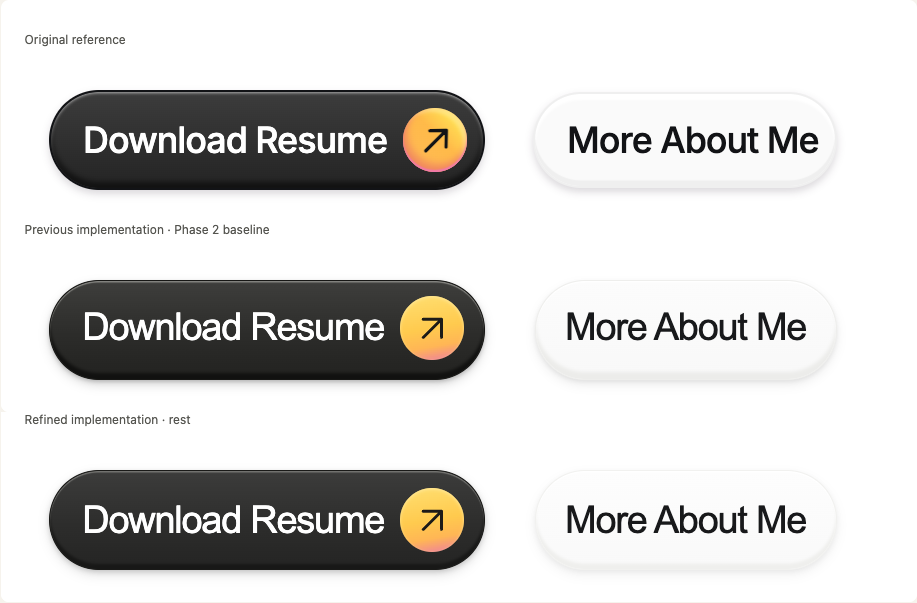
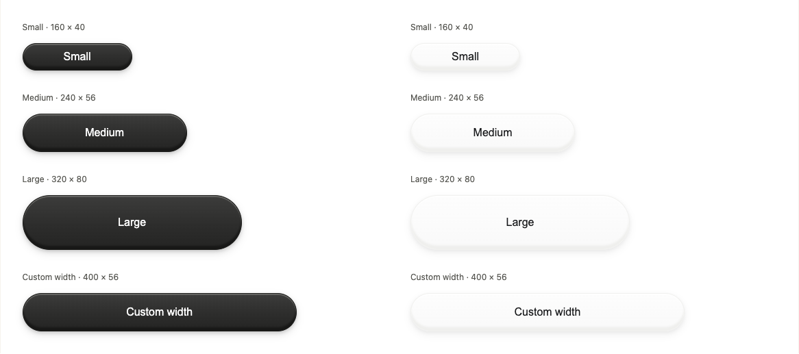

# Surface Engine refinement · Phase 2.1

Implemented on 25 October 2026 in `feat/surface-engine`, starting from clean commit `7bc12d2`. Changes remain uncommitted for review. No packages were published; no commits were pushed or merged. Phase 3 has not begun. Implementation and web visual review are ready for user approval; native device visual acceptance remains outstanding.

## What changed

Only shared recipe values and consuming calibration fixtures changed. Both existing DOM and native adapters consume the refined recipe without adapter API changes, new dependencies, materials, or renderer infrastructure. Pill geometry, the 1.5px outer border, the 55% middle fill stop, native 24-band rendering, content ownership, and state/depth formulas remain intact. Typography remains in the labs: web live specimen 600 → 500, web reference study 500 → 400, native specimen 600 → 500. Arial maps 400/500 to the same available regular face here; the reference label improvement comes mostly from removing 0.4cqw bottom padding, restoring a more centered baseline. No source-font identity is claimed.

The Surface primitive owns material, depth, lighting, borders, and visual state. Components own content, layout, interaction semantics, and composition. Decorative accents are optional component-level compositions, not mandatory surface features.

## Recipe record

Values below apply at rest, depth 1. See [previous recipe JSON](previous-recipes.json) and [refined recipe JSON](refined-recipes.json) for the full records, including unchanged foregrounds and state metadata.

| Material / value                     | Phase 2                       | Phase 2.1                     |
| ------------------------------------ | ----------------------------- | ----------------------------- |
| Polished fill top / middle / bottom  | `#3e3e3c / #2c2c2a / #222220` | `#3c3c3b / #2d2d2c / #242423` |
| Polished edge                        | `#171715`                     | `#1a1a18`                     |
| Polished highlight                   | `#858581`                     | `#747471`                     |
| Polished lower shade / lip           | `#111110 / 6`                 | `#181817 / 5`                 |
| Polished contact / ambient opacity   | `0.18 / 0.14`                 | `0.15 / 0.11`                 |
| Porcelain fill top / middle / bottom | `#fcfcfc / #fafafa / #f8f8f8` | `#fdfdfd / #fbfbfb / #f9f9f9` |
| Porcelain edge                       | `#eeeeec`                     | `#f1f1ef`                     |
| Porcelain highlight                  | `#ffffff`                     | preserved                     |
| Porcelain lower shade / lip          | `#ececea / 7`                 | `#efefed / 5.5`               |
| Porcelain contact / ambient opacity  | `0.06 / 0.07`                 | `0.045 / 0.055`               |
| Both: contact offset / blur          | `2 / 4`                       | `2 / 5`                       |
| Both: ambient offset / blur          | `5 / 10`                      | `5 / 11`                      |
| Both: Android elevation              | `4`                           | `3.5`                         |

Press still scales depth to 0.25; hover to 1.2; disabled to 0.4 with opacity 0.5. Depth 0 still removes lip, cast shadow, lift, and elevation. Theme radii, fixed reference palettes, customizable surrounding semantic colors/accent, static accessibility behavior, and absence of animation remain unchanged.

## Visual evidence and judgment

Before changing recipes, captured the existing production lab and both resolved recipes, then inspected the canonical 916 × 166 reference. Baseline captures come from the pre-edit production build. After captures come from the rebuilt production application. Captures use headless installed Chrome at device scale 1. Reference and comparison rows use the same white background and 916 × 166 dimensions. Smooth scrolling was disabled during final capture to avoid screenshot stitching artifacts; this is capture-only configuration.

[Original](original-reference.png) · [Before](before-916.png) · [After](after-916.png)

Visual review: polished retains its charcoal face and physical depth, with a narrower, lighter lower band and softer upper rim. The slightly narrower fill range avoids the old abrupt near-black lower transition. Porcelain remains distinguishable from white via its preserved highlight, restrained border, lower lip, and cast shadow; the lower edge is softer. Geometry stays recognizable, including the existing slight difference from the source porcelain's vertical placement. These are controlled refinements, not a pixel-match claim. The unknown font/glyph metrics, source antialiasing and bevels, and warm medallion still differ. The accent was deliberately left as existing lab composition and is absent from Surface.

Reviewed desktop 1440 × 1000 and mobile 390 × 844 in light/dark, tablet 768 × 1024 in dark, full-size comparison, both materials at 160 × 40, 240 × 56, 320 × 80, and 400 × 56, plus pressed state with 16px radius and mobile overlay. Narrow-screen widths clamp to the available canvas; the size labels describe requested dimensions. No unintended page overflow or clipped pill/shadow layers was found in the final captures. The image overlay intentionally reveals remaining glyph/medallion differences.

[Desktop light](after-desktop-light.png) · [Desktop dark](after-desktop-dark.png) · [Mobile light](after-mobile-light.png) · [Mobile dark](after-mobile-dark.png) · [Tablet dark](after-tablet-dark.png)

[Mobile geometry](geometry-mobile.png) · [Pressed, radius 16](geometry-pressed-radius16.png) · [Mobile overlay](overlay-mobile.png)

## Lab behavior

The existing page structure and controls remain. Stacked comparison now displays original / fixed previous screenshot / refined reconstruction. Overlay still places the original over the live refined reconstruction and retains opacity control. The previous image is explicitly labeled as a fixed rest/depth-1/pill baseline; changing state/depth/radius affects the refined study and size examples, not the historical capture. Material selection continues to affect the live specimen only. Both labs add standalone size examples without arrow accents. Native examples use scalable text and minimum content heights; native font scaling can increase their height.

## Exact verification

Node 24.21.0, pnpm 10.34.8. The shell initially resolved pnpm 11.25.0, which correctly stopped at the repository engine check; a temporary local command shim selected the already-cached pinned pnpm for all nested scripts. No repository toolchain or lockfile changes were needed.

| Check                                           | Result                                                                                                                                                                                           |
| ----------------------------------------------- | ------------------------------------------------------------------------------------------------------------------------------------------------------------------------------------------------ |
| `pnpm check`                                    | Exit 0; includes lint, typecheck, tests, builds, packed consumers                                                                                                                                |
| ESLint                                          | Passed with zero warnings                                                                                                                                                                        |
| TypeScript                                      | All six packages/apps plus tooling/test projects passed                                                                                                                                          |
| Vitest                                          | **35/35 passed in 7 files**: tokens 2, theme 16, DOM 9, native 8                                                                                                                                 |
| Library builds                                  | Four packages emitted ESM/CJS, types, source maps; unchanged tasks may reuse Turbo cache                                                                                                         |
| Next.js production                              | Passed; `/`, `/_not-found`, `/surface-lab` prerendered                                                                                                                                           |
| Expo production export                          | iOS and Android Hermes bundles exported, each about 1.6MB, reference asset included                                                                                                              |
| Packed package checks                           | Four archives passed exports/types/README/dependency checks; packed ESM/CJS theme + DOM SSR passed                                                                                               |
| `PLAYWRIGHT_CHANNEL=chrome pnpm test:browser`   | **4/4 passed** in 6.0s; desktop/mobile foundation and Surface Lab                                                                                                                                |
| Browser coverage                                | Controls, state/depth/radius, baseline loading, geometry sizes, overlay alignment/opacity, reset, theme/accent foundation, keyboard navigation, first-viewport specimen, no page errors/overflow |
| `pnpm --filter @tactile-ui/showcase run doctor` | Exit 0; dependencies up to date                                                                                                                                                                  |
| `pnpm changeset status`                         | Exit 0; existing pending minor plan only, no version/publish operation                                                                                                                           |
| Visual inspection                               | Completed on actual Chrome captures described above; no native screenshots claimed                                                                                                               |
| Design detector                                 | One existing Arial advisory; retained intentionally in reference-only calibration typography, no documentation font redesign                                                                     |
| Native runtime / binary checks                  | Not performed: no booted iOS simulator or attached Android device; exports do not validate device appearance                                                                                     |

`pnpm format:check` and `git diff --check` both passed (exit 0). Logs are available with the delivered review bundle: `check.log`, `browser-tests.log`, `expo-doctor.log`, and `changesets.log`.

## Cross-platform limitations and remaining fidelity

- Native 24 solid fill strips approximate a continuous gradient. Solid top/bottom rims approximate inset lighting without inset blur.
- iOS maps blur to shadowRadius = blur / 2; Android uses OS elevation, now 3.5 × state/depth factor. Android cannot independently reproduce the two web opacity/falloff layers. Device appearance needs validation, particularly Android's elevation response.
- Shared numeric refinements reach both adapters and native mapping tests pass, but that is not a native visual verdict. iOS/Android binary builds, phone/tablet runtime appearance, Dynamic Type/font scale, native screen readers, and an external bare React Native host remain unverified.
- Tiny scaled comparison frames retain physical CSS border/shadow widths. Use 916px frames for material judgment. Native dimensions are dp and include platform text metrics.
- Unknown source font, icon placement/color field, source antialiasing, bevel, and porcelain placement remain visible differences. No image-difference score or pixel-parity claim is made.
- No limitation found justifies adding Skia for this refinement. Preserve lightweight native views; evaluate optional advanced rendering separately only if device evidence requires it.

## Phase 3 recommendation — wait for approval

1. Obtain approval of refined surfaces and record any remaining material feedback; verify iOS and Android reference studies on a phone and tablet before claiming native visual acceptance.
2. Define the Button contract: variants/sizes, label/icon slots, content padding, focus treatment, loading and disabled semantics, and accessible names. Keep layout and typography in Button.
3. Compose the approved Surface under native Pressable and semantic DOM button hosts. Derive visual states from platform interactions while preserving keyboard focus, activation, disabled behavior, and touch targets.
4. Add the optional gradient circular arrow accent in Button composition. A plain Button and a standalone Surface must remain valid without it.
5. Add focused interaction/accessibility tests, reduced-motion behavior only if animation is introduced, and browser/device visual fixtures before expanding the catalog. Keep haptics, animation engines, publishing, and advanced renderers separately opt-in.

The existing engine and adapter boundaries support that plan without architectural replacement. No production Button implementation is included here.
