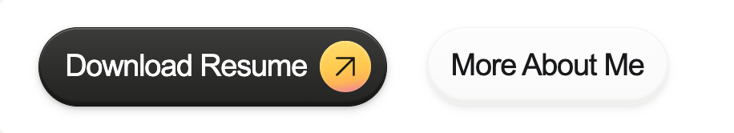
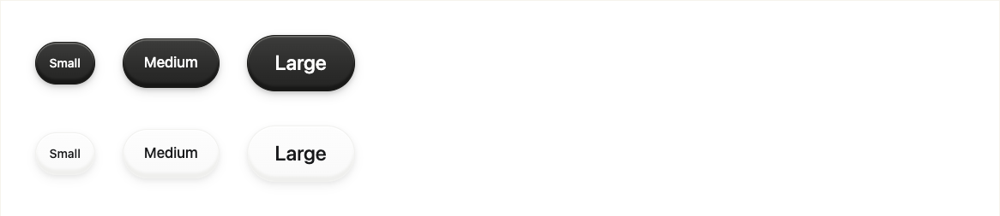

# Phase 3 web visual evidence

Captured from the actual Next.js production Button Lab with installed Chrome at scale 1, from branch `feat/button-component` based on approved `0d2c4ce`. Full pages begin at document top; smooth scrolling is disabled only during capture. Each viewport/theme uses a fresh browser page to avoid full-page compositor artifacts. Focus capture includes padding for the outline. Native device evidence is unavailable; these are web screenshots.

[Canonical original](original-reference.png) · [Desktop light](desktop-light.png) · [Desktop dark](desktop-dark.png) · [Mobile light](mobile-light.png) · [Mobile dark](mobile-dark.png) · [Tablet light](tablet-light.png)

[Keyboard focus](keyboard-focus.png) · [Pressed](pressed.png) · [Loading](loading.png)

The composition uses real Buttons, a showcase-only warm trailing accent, and label/sizing styles matching the reference scale. It preserves the approved polished/porcelain material recipes. Remaining differences include source font/antialiasing, medallion color field, glyph shape/placement and the inherited porcelain vertical placement. The accent remains optional; ordinary variants contain no warm circle. The fixed 916px reference study scrolls inside its own container on narrow screens.

Visual review confirmed coherent pill geometry, aligned icons/text, subtle hover/press depth, retained material identity, visible focus outline, and stable loading dimensions. No page overflow or page errors were recorded in the captures or final browser suite. Browser coverage is Chromium/Chrome on desktop and emulated mobile; no Safari, Firefox, or device browser result is claimed.

See [Button API and platform limits](../BUTTONS.md) and [verification progress](../PROGRESS.md). The independent reviewer returned ship for the reviewed web finish, with the requested padded focus evidence recaptured.
